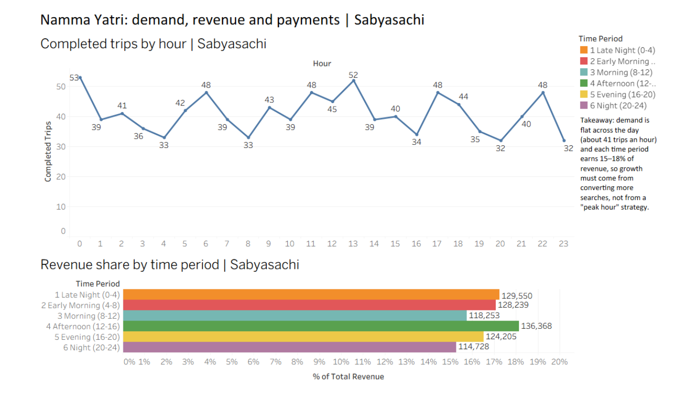
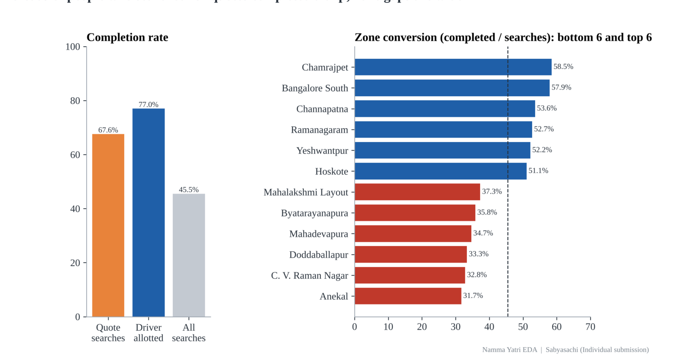
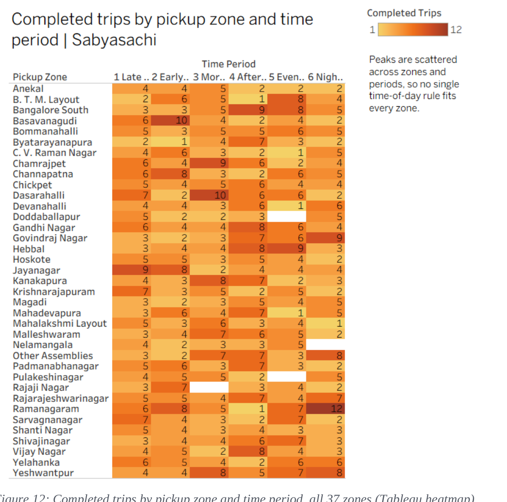
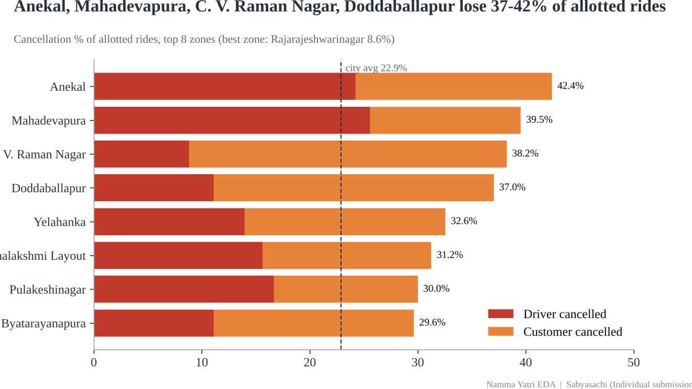
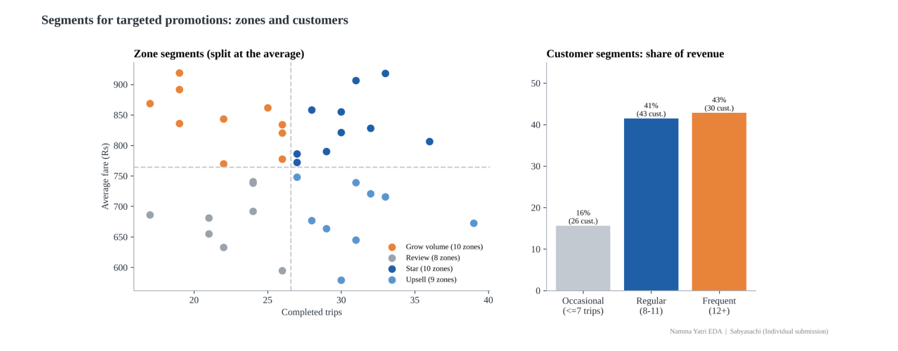

# Namma Yatri EDA — Turning Searches Into Rides

Exploratory data analysis and data storytelling on Namma Yatri (Bengaluru auto-rickshaw ride-hailing) data, built in Tableau Public with supplementary Python analysis. Analyzed 2,161 ride searches across 37 Bengaluru zones to find where demand is highest, why searches don't convert into completed rides, and how to allocate drivers and marketing spend more effectively.

**Tools used:** Tableau Public, Python (pandas, matplotlib)

## Executive Summary

Namma Yatri recorded 2,161 ride searches, of which 983 became completed rides (45.5%) earning ₹7,51,343 (average fare ₹764). **The business has a conversion problem, not a timing problem** — demand and revenue are flat across the day, but booking-funnel losses and zone-to-zone performance vary enormously.

## Key Insights

**Demand is flat across the day — there is no rush hour.** Completed trips average 41 an hour, and every time period earns 15.3%–18.1% of revenue. Hour of day has essentially no relationship with fare (r = -0.01), so peak-hour or surge pricing tactics have no support in the data. Revenue instead tracks trip volume almost perfectly (r = 0.90).

**Most losses happen before a ride even starts.** 40.9% of all searches never get a driver allotted. Of the 1,277 rides that did get a driver, 77.0% finished, 12.3% were cancelled by the customer, and 10.7% by the driver. Overall, 67.6% of searches that reached the quote stage ended in a completed trip — and this ratio swings from 31.7% (Anekal) to 58.5% (Chamrajpet) by zone.

**Zone-level demand patterns hide inside a flat city-wide total.** Each zone has its own busy window — Ramanagaram peaks at Night (12 trips) but has just 1 in the Afternoon; Dasarahalli peaks in the Morning; Hebbal peaks in the Evening. A single city-wide driver roster would over-supply some zones and under-supply others.

**Cancellations cluster in four specific zones with different root causes.** Anekal (42.4%), Mahadevapura (39.5%), C.V. Raman Nagar (38.2%), and Doddaballapur (37.0%) lose far more allotted rides than the city average (22.9%). In Anekal and Mahadevapura, most cancellations come from drivers — pointing to unattractive pickups or too few drivers. In C.V. Raman Nagar and Doddaballapur, they come mainly from customers — pointing to long wait times.

**Targeted segments reveal where growth and loyalty efforts should focus.** Ten "grow-volume" zones combine high fares with low completed-trip counts — ideal for regional marketing pushes. On the customer side, just 30 "frequent" riders (12+ trips) generate 43% of total revenue, making a loyalty program a high-leverage next step.

## What's Covered

1. Data preparation — joining 5 source tables (Assembly, Trip_Details, Trips, Duration, Payment) into one master dataset in Tableau
2. Data cleaning and inconsistency resolution — cancellation flag logic, misleading column names, fare outliers
3. Exploratory analysis — univariate, segmented-univariate, and bivariate analysis across time, zones, and payment methods
4. Booking funnel analysis — estimate → quote → allotment → completion, with zone-level conversion breakdown
5. Zone performance analysis — demand vs. revenue vs. conversion, zone × time-period heatmap
6. Customer and zone segmentation for targeted marketing (supplementary Python analysis)
7. Operational and marketing recommendations with KPIs to track

## Recommendations

- Raise driver allotment rate from 59% to 70% via acceptance incentives and faster re-assignment
- Fix the 8 weakest-converting zones first (target: ≥45% conversion for all zones)
- Position drivers by zone-and-period rather than a single city-wide roster
- Move the remaining 24% cash users to UPI/cards with cashback incentives
- Target marketing at high-fare, low-volume zones (Byatarayanapura, Rajaji Nagar, Doddaballapur, and others)

## Data Source

Namma Yatri trip search and completion data for Bengaluru — 2,161 ride searches across 37 assembly zones, covering search outcomes, cancellations, fares, distances, payment methods, and driver allotment.

## Full Report

See [`ADV_Namma_Yatri_Report_Sabyasachi.pdf`](ADV_Namma_Yatri_Report_Sabyasachi.pdf) for the complete 22-page methodology report with all supporting charts and tables.

## Presentations

- [`ADV_Namma_Yatri_PPT1_Technical_Sabyasachi.pptx`](ADV_Namma_Yatri_PPT1_Technical_Sabyasachi.pptx) — technical methodology deck for an operations/technical audience
- [`ADV_Namma_Yatri_PPT2_Business_Sabyasachi.pptx`](ADV_Namma_Yatri_PPT2_Business_Sabyasachi.pptx) — findings and recommendations deck for business leadership

## Dashboard

See [`ADV_Namma_Yatri_Dashboard_Sabyasachi.pdf`](ADV_Namma_Yatri_Dashboard_Sabyasachi.pdf) for the full set of interactive Tableau dashboards.
